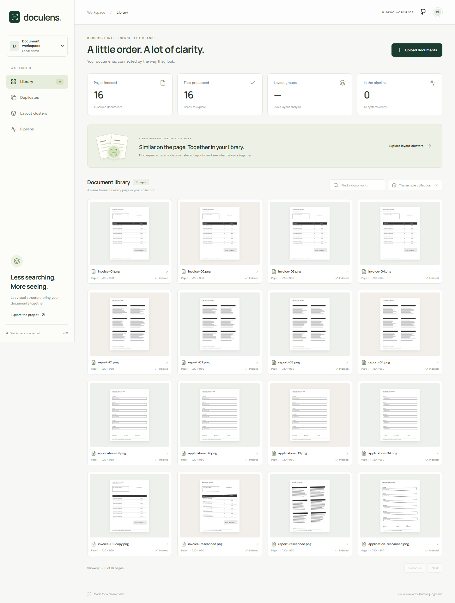
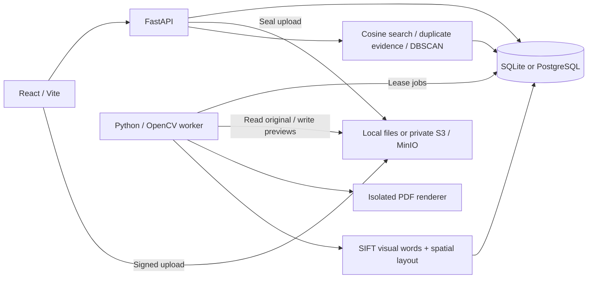

# DocuLens

**A little order. A lot of clarity.**

Visual document organization with a real computer-vision pipeline: upload scanned pages, inspect duplicate evidence, explore shared layouts, and find visually similar documents.

[](https://github.com/atbakhru/doculens/actions/workflows/ci.yml)



## Try it locally

Requires **Python 3.12** and **Node.js 22**. The default demo uses SQLite and local files; no cloud account or API key is needed. Fonts and the visual vocabulary ship with the app.

```bash
git clone https://github.com/atbakhru/doculens.git
cd doculens
python -m venv .venv
# macOS / Linux
source .venv/bin/activate
# Windows PowerShell instead: .\.venv\Scripts\Activate.ps1
python -m pip install -r requirements.txt
cd apps/web
npm ci
cd ../..
python scripts/dev.py
```

Open **http://127.0.0.1:5173** and choose **Explore sample collection**. Sixteen synthetic pages pass through the actual API, storage, database queue, and worker. Open **Layout clusters → Find layout groups** to create the first cluster run. API documentation: **http://127.0.0.1:8000/docs**. Stop the launcher with Ctrl+C.

For PostgreSQL + private MinIO object storage + independent API/worker/web containers:

```bash
docker compose -f infra/docker/compose.yml up -d --build
# Open http://localhost:5173
python scripts/smoke.py  # requires httpx, included in requirements.txt
docker compose -f infra/docker/compose.yml down
```

Docker's fixed credentials are local demonstration credentials. Ports bind to loopback. `down` retains the database/object volumes.

## What works

- **Ingestion:** signed uploads, PNG/JPEG/PDF validation, 20 MB files, 30-page PDFs, 100-file batches, isolated PDF rendering with a timeout, thumbnails, and source provenance.
- **Durable processing:** database-backed queue, atomic claims, leases, attempt fencing, retries, terminal failures, and idempotent completion. API and worker are separate processes.
- **Duplicate review:** SHA-256 exact matches; perceptual-hash and layout candidate screening; SIFT matching, RANSAC, alignment refinement, and ink consistency for near-match evidence. Both originals are retained.
- **Visual organization:** a frozen 128-word SIFT vocabulary plus 128 spatial features, versioned 256-dimensional vectors, exact cosine similarity search, bounded DBSCAN runs, noise labels, run history, and user-renamed groups.
- **A usable interface:** responsive library, filename search, batch filters, pagination, page inspector, side-by-side comparisons, processing activity, retry controls, and JSON report export.
- **Engineering evidence:** unit/integration tests, Playwright flows, a Compose smoke test, a native C++ parity experiment, CI, measured evaluation, and deployment/runbook documentation.

## Architecture



Object storage owns bytes; the database owns metadata, vectors, jobs, and versioned clustering snapshots. The local queue intentionally uses database leases instead of SQS so the entire application is reproducible without AWS. See [architecture and tradeoffs](docs/ARCHITECTURE.md).

## Reproduce the evidence

```bash
python -m pytest -q
python -m ruff check .
python -m scripts.fixtures
python -m scripts.evaluate --output docs/benchmark.json
cd apps/web
npm run build
npx playwright install chromium
npm run test:e2e
```

[The checked-in evaluation](docs/benchmark.json) includes confusion matrices, false-positive examples, cluster homogeneity, adjusted Rand score, measured extraction throughput, hardware/software context, and explicit exclusions. The corpus contains 16 generated pages across three layout families, with exact copies and rotated rescans. Training uses a separate seed, but the same three template families; this is **a small synthetic evaluation**, not evidence of real-world generalization. Thresholds were developed against this corpus and should be validated on independent scans.

**No claim of 200 pages/second, production-grade duplicate accuracy, C++ speedup, or observed Kubernetes autoscaling is made.** Near-match candidates require human review. Layout groups are not OCR or semantic classification.

## Present the project

Use the [five-minute interview walkthrough](docs/INTERVIEW.md) for a live demo, architecture discussion, failure demonstration, and honest resume language. The repository includes [deployment and rollback instructions](docs/DEPLOYMENT.md) and [scope/status](docs/STATUS.md).

| Area | Implementation |
|---|---|
| Browser | React, TypeScript, Vite, Lucide, locally bundled fonts |
| API / persistence | FastAPI, Pydantic, SQLAlchemy, SQLite or PostgreSQL |
| Vision | OpenCV SIFT, RANSAC, ECC alignment, pHash, scikit-learn DBSCAN |
| Storage | Local signed object endpoints or S3-compatible presigned URLs |
| Packaging | Docker Compose; parameterized Kubernetes deployments and 3–20 HPA |
| Native experiment | C++17 SIFT CLI, same-build OpenCV parity test; separate from the default worker |

## Boundaries

This is an interview/demo application with a complete local path. Hosted mode supports workspace bearer tokens and tenant-scoped queries; it is not a full identity/role-management system. Public deployment needs TLS, gateway rate limits, managed secrets, a private database, object lifecycle policies, and stronger sandboxing for hostile uploads. SQS/KEDA, Terraform/EKS provisioning, OCR, pgvector/HNSW, and semantic models are future extensions. Kubernetes manifests describe a deployment configuration; they do not establish that scaling was observed.
