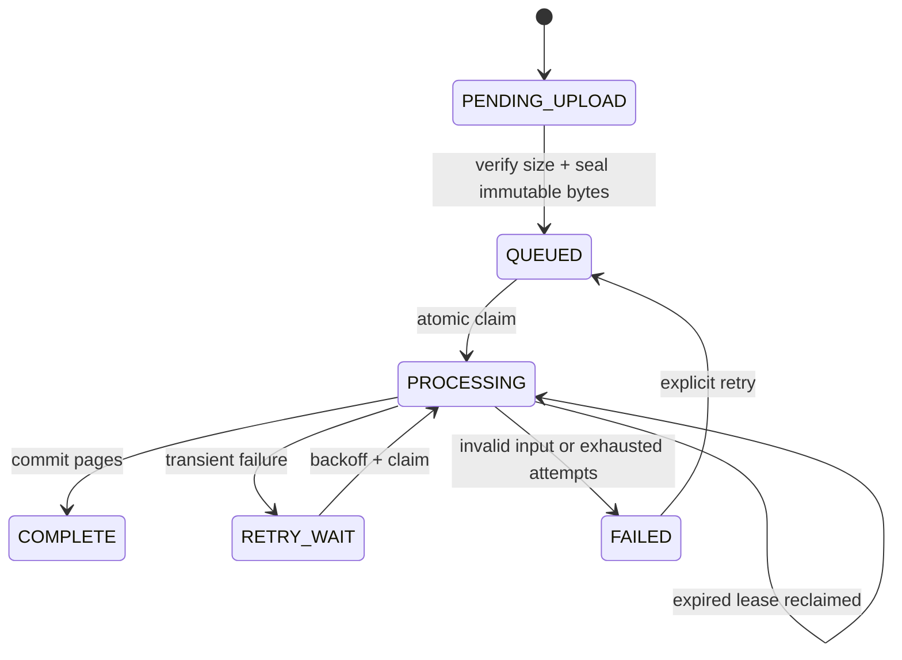

# Architecture and decisions

## The unit of work

A batch owns up to 100 documents. Each document owns a durable processing job and zero or more pages. Its states are:

The `documents` row deliberately holds job state, avoiding a redundant jobs table in the MVP. Claims use a conditional SQL update, so only one worker wins a particular claim even when many pollers select the same candidate. A random lease token fences stale workers from updating progress or committing results. Page writes and `COMPLETE` commit together; `(document_id, page_no)` is unique. A five-minute lease is renewed between pages. Expired third attempts become `FAILED` rather than remaining stuck forever. Graceful termination completes the active document.

Clustering has its own `cluster_runs` record. Completing feature extraction does not imply that clustering occurred. Runs retain the page-to-label snapshot, actual codebook version, eps, min_samples, and display names. Clustering is synchronous and bounded at 500 pages; this makes its completed/failed request semantics explicit rather than inventing asynchronous progress.

## Storage and authorization

Presign reserves an unguessable, tenant-prefixed original key. Local signed URLs authenticate the key, operation, and expiry with HMAC-SHA256. S3/MinIO uses SigV4. Completion verifies the actual size and seals bytes to a different key before queuing. This matters because an unexpired presigned PUT can be reused: workers never consume an original that a client can still replace. Metadata paths enforce the token's tenant; signed previews are short-lived bearer capabilities. Never forward a preview URL to an unauthorized recipient.

Demo mode uses one anonymous workspace and synthetic data. Private mode requires `API_TOKEN` and `SIGNING_KEY`; optional `API_TOKENS` maps additional opaque tokens to workspace identifiers. The client stores its access token in sessionStorage, not in a compiled Vite environment variable. Tokens are a minimal access-control mechanism, not a substitute for OIDC, rotation, audit trails, or roles.

Files are bounded at 20 MB and images at 24 megapixels. Signatures are validated against the declared PNG/JPEG MIME type. PDFium runs in a disposable process with a 90-second timeout, at most 30 pages, and maximum render dimension 1,200. Container memory/CPU limits provide another boundary. A subprocess is not a security sandbox: a public hostile-upload service should add seccomp/network isolation and stronger per-document quotas. Thumbnails are PNG, not user-provided HTML/SVG. No user filename becomes a filesystem key.

## Why this representation?

Raw SIFT descriptors have a variable number of keypoints and cannot be compared as fixed-length document vectors. We quantize them against a frozen 128-center visual vocabulary, then build a normalized square-root histogram. The histogram is combined with an 8×16 spatial ink map to retain page structure that a bag of words discards.

`embedding = L2_normalize(concat(0.35 × BoVW128, sqrt(1 − 0.35²) × layout128))`

The vocabulary is trained on deterministic synthetic seed 713 and shipped as a safe NumPy array (no pickle). Its SHA-256 digest is part of the model version. `python -m scripts.train` regenerates it; reprocess all existing pages before mixing new and old embeddings. All comparison/search/cluster operations enforce the version. The stored vector is 256-dimensional; a future pgvector schema must use `vector(256)`, not the blueprint's BoVW-only `vector(128)`.

Cosine search is exact and capped at 5,000 pages. DBSCAN uses cosine distance, default eps 0.11, min_samples 2, and at most 500 pages. Noise is -1. These are exposed parameters, not semantic class thresholds. The SQL JSON representation is intentionally portable; HNSW is unnecessary for this demo scale.

## Duplicate detection

1. Exact SHA-256 of original image bytes or rendered PDF-page bytes is deterministic identity at that representation level.
2. pHash Hamming distance ≤14 screens near candidates. A cosine ≥0.94 fallback improves recall for small rotations that disrupt pHash.
3. SIFT ratio-test matches feed RANSAC homography (4-pixel reprojection threshold). At least 12 inliers and 65% inlier agreement are required.
4. ECC refines the alignment. A symmetric ink mismatch check with a one-pixel tolerance rejects some shared-template false positives.
5. The UI shows evidence and preserves both documents. It never equates an inlier ratio with a calibrated probability of duplicate content.

The benchmark compares SHA-only, pHash-only, and the full candidate+geometry+ink path. Crops, severe skew, low-texture pages, handwriting, changed small fields, and dense shared templates remain challenging. Parameters were refined using the small synthetic corpus; independent real scans are needed for any accuracy claim.

## Why database leases before SQS?

The queue is transactionally adjacent to metadata, needs no cloud credentials, survives worker restarts, and supports multiple workers. Polling and claim contention limit scale; an outbox plus SQS would be the next step. SQS delivery is at-least-once, so the same fencing/idempotency principles still apply. A production adapter should use an outbox, renewable visibility, DLQ redrive, and measured backlog scaling. No incomplete SQS adapter is enabled here.

## Native code and autoscaling

Python OpenCV already executes C++. The separate C++17 CLI is a parity/measurement experiment, not a claimed optimization. Its Docker harness builds against one system OpenCV and compares descriptors with that same Python binding. The primary worker remains Python/OpenCV until a measured bottleneck justifies integration.

The Kubernetes HPA requests CPU scaling from 3 to 20 worker replicas. It requires Metrics Server and adequate node capacity. CPU load is not queue depth; KEDA may be appropriate for a future SQS queue. The database pool, object-store bandwidth, duplicate verification cost, and DBSCAN memory all need measurement before scaling claims.

## Primary technical references

- [OpenCV feature matching and homography](https://docs.opencv.org/4.x/d1/de0/tutorial_py_feature_homography.html)
- [scikit-learn DBSCAN and memory behavior](https://scikit-learn.org/stable/modules/generated/sklearn.cluster.DBSCAN.html)
- [FastAPI request handling](https://fastapi.tiangolo.com/tutorial/request-files/)
- [S3 presigned upload semantics](https://docs.aws.amazon.com/AmazonS3/latest/userguide/PresignedUrlUploadObject.html)
- [Kubernetes HPA](https://kubernetes.io/docs/tasks/run-application/horizontal-pod-autoscale/)
